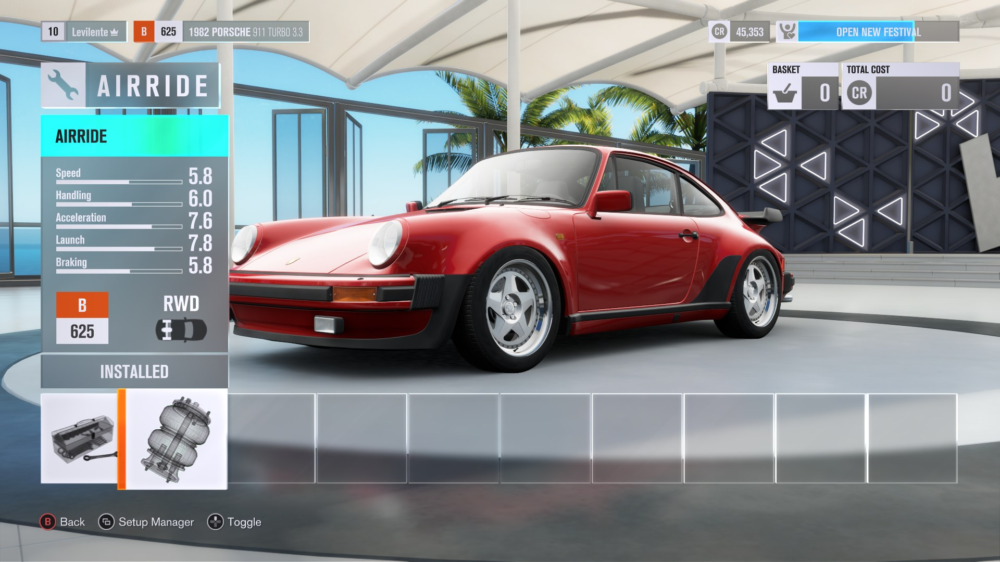
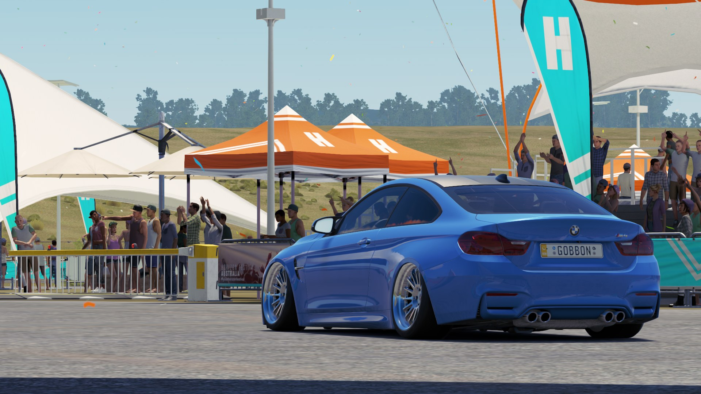
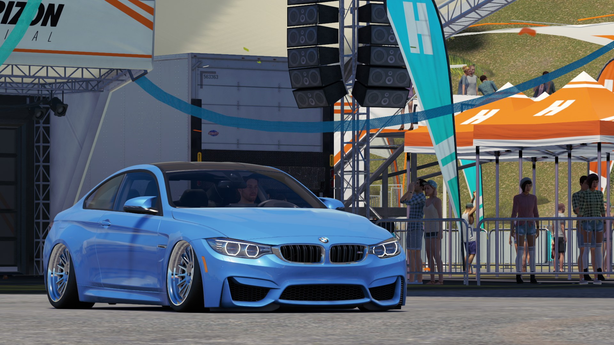

# Airride (FH3)

Air suspension for every car in **Forza Horizon 3** (the Xbox One build on PC, through the Azimuth launcher), on the
**[FH3 Mod Platform](https://github.com/Levilente/FH3_ModPlatform)**. Buy the Airride in the garage, park, hold **L3** and the
car slowly sinks to the ground; hold it again or drive off and it comes back up.





> Version **1.0.0**. Needs the FH3 Mod Platform **1.0.0** or newer.

## What it does

- **An upgrade you buy.** **Garage > Upgrades > Platform and Handling > Airride**: *Stock* or *Airride* (3 000 CR by default). It is stored
  per owned car, like the game's own parts.
- **Lower it with L3.** Below 20 km/h, hold **L3** (press in the left stick) for one second: the car sinks smoothly (it eases in and out).
  Hold L3 again to raise it. Go faster than 20 km/h and it rises by itself.
- **Set the drop per car.** The car's **Tuning > Springs** page gets an **Airride** row: **Drop**, 1 to 10 cm in 0.1 cm steps. The row is
  only there on cars that have the Airride. A car whose row was never touched drops 5 cm.
- **Camber that fits.** Every centimetre of drop adds a little negative camber (0.65 degrees by default), so the wheels tuck under the arches.
- **Preview in the shop.** While the cursor is on the Airride stage in the garage, the showroom car sits lower, so you see it before you buy.
- **Only your own cars.** Showcase cars, loaners and AI cars never get it (the platform decides which car is yours).

By default only the picture moves: the car's body and wheels are drawn lower, its physics stay as they are, so the lowered car drives exactly
like before. `Visual=0` lowers the suspension itself instead (see the settings).

## Requirements

| What | Version |
|---|---|
| Forza Horizon 3 on PC with the **Azimuth** launcher | Xbox One build 1.0.125.0 (the one the platform targets) |
| **[FH3 Mod Platform](https://github.com/Levilente/FH3_ModPlatform)** | **1.0.0 or newer** |
| A controller | L3 is read from any XInput controller; there is no keyboard key |

If another platform-based mod already runs for you, you have the platform; otherwise download its zip from its
[releases page](https://github.com/Levilente/FH3_ModPlatform/releases/latest).

## Install

1. Close the game.
2. Download `Airride.dll` from the [latest release](../../releases/latest).
3. Copy it into the `fh3-mods` folder next to `azimuth.exe` (the platform makes the folder).
4. Start the game. Open a car in the garage: **Upgrades > Platform and Handling > Airride**, buy it, set the drop on **Tuning > Springs**,
   go driving, stop and hold **L3**.

The platform's *Installed mods* page (**Home > MODS**) lists the mod and checks this repository for new releases. The mod's lines in
`fh3-mods\platform.log` start with `[Airride]`.

## Uninstall

Close the game and delete `fh3-mods\Airride.dll` (and `Airride.ini`). The platform keeps which cars had the Airride, so it comes back if you
reinstall the mod.

## Settings (`fh3-mods\Airride.ini`)

The mod writes the file with these values on its first start. Restart the game after editing it.

| Key | Default | Meaning |
|---|---|---|
| `Price` | `3000` | Credits for the Airride. |
| `HoldMs` | `1000` | How long L3 is held to lower or raise (milliseconds). |
| `DefaultDropCm` | `5` | The drop of a car whose Tuning row was never touched (1 to 10). |
| `CamberPerCm` | `0.65` | Degrees of extra negative camber per centimetre of drop. |
| `Camber` | `1` | `0`: no extra camber. |
| `DurationSeconds` | `1.4` | How long lowering or raising takes. |
| `StandstillMps` | `5.56` | The car can be lowered below this speed (metres per second; 5.56 = 20 km/h). |
| `AutoRaiseMps` | `5.56` | A lowered car faster than this rises again. |
| `Visual` | `1` | `1`: only the picture is lowered. `0`: the suspension is lowered (the car drives lower too). |
| `HeightMode`, `BelowMinCm` | `0`, `1.5` | With `Visual=0`: `0` shifts the suspension's ride height range, `1` lowers the ride height tuning value; how far below the game's own lowest ride height the car may go. |
| `CamberSign` | `1` | `-1` if the wheels lean the wrong way in the visual mode. |
| `Log` | `0` | `1` writes what the mod does to `fh3-mods\platform.log` (for bug reports). Problems are always logged. |
| `PreviewScope`, `StepMs`, `Probe`, `Trace` | | For bug hunting; leave them as they are. |

The drop of each car is kept under `[Drop]` (garage id = centimetres); the Tuning row writes it.

## How it works

- The upgrade comes from the platform's upgrade bridge (`register_upgrade`), the Tuning row from `add_tuning_row`, the shop preview from
  `upgrade_preview_stage`. Whose car it is comes from the platform too (`upgrade_stage` of the driven car is 0 in a car that isn't yours).
- The mod hooks `Car::Update` (`game+0x18B8D20`) and finds the player's car through the HUD controller (`game+0xB26690`). In the visual mode it
  moves the car's render parts down (the body by the drop, the wheels with the camber), in the physical mode it writes the suspension values
  of the car's spec (`Car+0x140`) and has the game re-apply them. The comment at the top of `src/airride.cpp` has the offsets.
- The upgrade icon is `icons/airride.png`, handed to the game with the platform's `set_file`; no game file is changed.

## Icon

`icons/airride.png` (200 x 200) is the upgrade tile; the large picture is the game's Springs and Dampers one. To change it, replace the PNG
and run `python3 scripts/gen_icons.py --prefix airride` (pillow, numpy), then rebuild.

## Build

```sh
git submodule add https://github.com/Levilente/FH3_ModPlatform platform   # once
cmake -S . -B build -G Ninja -DCMAKE_TOOLCHAIN_FILE=platform/cmake/mingw-w64-x86_64.cmake
cmake --build build
```

The result is `build/Airride.dll` ([llvm-mingw](https://github.com/mstorsjo/llvm-mingw/releases); see the platform's
`docs/writing-a-mod.md` and `docs/car-mods.md`). Releasing: [RELEASING.md](RELEASING.md). Changes: [CHANGELOG.md](CHANGELOG.md).

## License

MIT, see [LICENSE](LICENSE). This is an unofficial fan modification, not affiliated with Playground Games, Turn 10, Microsoft or the
Azimuth developers. Forza Horizon 3 is a trademark of Microsoft.
